# PathSnap: Distributed Map-Matching & Route Reconstruction (Technical Report)

**UE24CS352A Machine Learning Hackathon.** Team: _<names / SRNs>_. Repository: _<public GitHub URL>_

> **Draft notice (delete before submission).** This draft was generated together with the code. Every number in it comes from the CSV/JSON files in `results/`, and every figure comes from `figures/` or `maps/`. Before you submit, the team must:
> 1. Rewrite the analysis in your own words.
> 2. Add the UI and API-log screenshots (Section 7).
> 3. Add the Folium screenshots marked _[screenshot]_.
> 4. Add the AI-assistance disclosure your event requires.
>
> Every member must be able to explain each section.

---

## 1. Problem summary

Each trip contains a 1 Hz GPS trace (`.track`), a local directed road graph (`.nodes`, `.arcs`) and a reference route (`.route`), which is the ordered list of arc ids the vehicle drove. For every GPS observation we predict the road arc it lies on, and from those predictions we rebuild a connected route.

The pipeline has four stages:

1. Candidate generation.
2. A per-candidate classifier that gives P(candidate is the reference arc).
3. HMM/Viterbi decoding over the candidates.
4. Route reconstruction with shortest-path gap filling.

It is deployed as a FastAPI service plus a Streamlit UI.

## 2.2 Dataset understanding and EDA

_Partitions used: train (80 trips) and student_test (10 trips). The evaluator partition was never opened._
_Code: `scripts/01_eda.py`. Outputs: `results/eda_*.csv`, `results/eda_summary.json`, `figures/eda_*.png`, `maps/eda_*.html`._

### Inventory

| | train | student_test |
|---|---|---|
| trips | 80 | 10 |
| GPS observations | 208,417 | 19,160 |
| GPS points per trip (min / median / max) | 361 / 1,529 / 19,313 | 262 / 1,420 / 3,958 |
| total driven length (km) | 2,978 | 297 |
| road-network nodes per trip (median) | 9,608 | 6,597 |
| road-network arcs per trip (median) | 19,527 | 13,145 |
| fraction of time steps exactly 1 s (mean over trips) | 0.938 | 0.982 |
| trips with a gap > 30 s | 28 | 2 |

All 90 trips have all four files.

### Missing-value analysis

`results/eda_missing_values.csv` checks each trip for the following:

- NaNs in the track and nodes files.
- Coordinates out of range or at (0,0).
- Arcs that point to node ids that do not exist.
- Route arc ids that do not exist.
- Duplicate or non-monotonic timestamps.

**All of these counts are zero in both partitions.** The data has no missing values in the usual sense. The real quality problems are the following:

1. **Time gaps.** Up to 160 s within one trip; 28 training trips have at least one gap over 30 s.
2. **GPS outliers.** Train trip 00000002 has fixes up to 567 m from the road.
3. **Disagreement between GPS and reference route.** In train trips 00000033 and 00000054, the median distance from a GPS fix to its aligned reference arc is above 120 m, which suggests a systematic offset (`figures/eda_gps_to_route_distance.png`).
4. **End-of-trip wandering.** For example, at the end of student_test 00000007 the vehicle drives around about 18 m off the network after the reference route has ended.

### Road network

- Each trip has its own subgraph.
- Every network has several weakly connected components (79/80 train trips and 10/10 student-test trips). They are clipped extracts, so border fragments are disconnected.
- There are no isolated nodes.
- Most streets are two-way, stored as two opposite arcs with identical geometry. This is why heading features are essential.
- Reference routes are almost perfectly continuous: consecutive route arcs share a node in 99.93% of transitions in train.

### Coordinates

- Columns are (longitude, latitude), which we checked against the plausible ranges. Trips are spread over several regions (`figures/eda_overview.png`, centroid panel).
- Degrees are not metres. At about 50°N, 1° of longitude is roughly 71 km while 1° of latitude is roughly 111 km.
- We project every trip onto a **local tangent plane (equirectangular) centred on the trip centroid**. Its error over a 20 km extent is below 0.1%, which is negligible against 5 m GPS noise. All distances below are in metres.

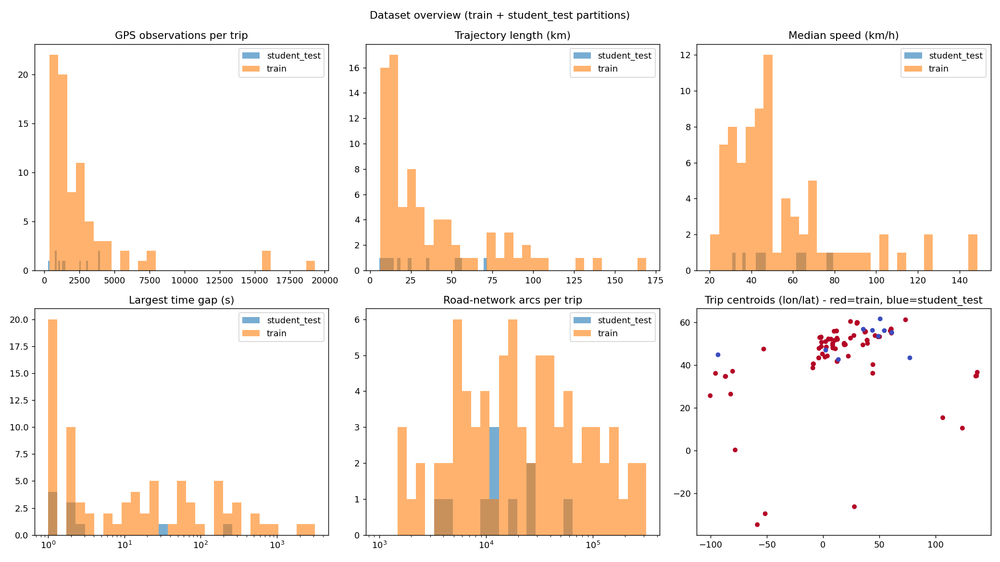
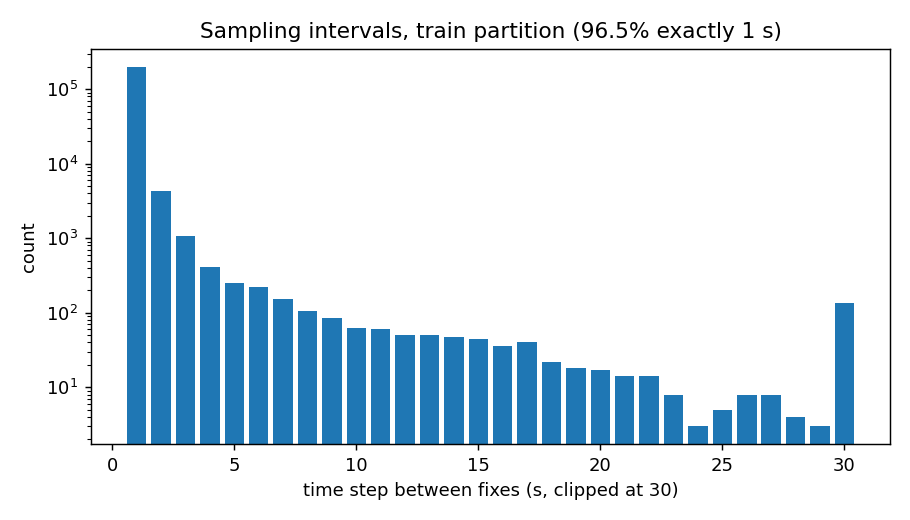
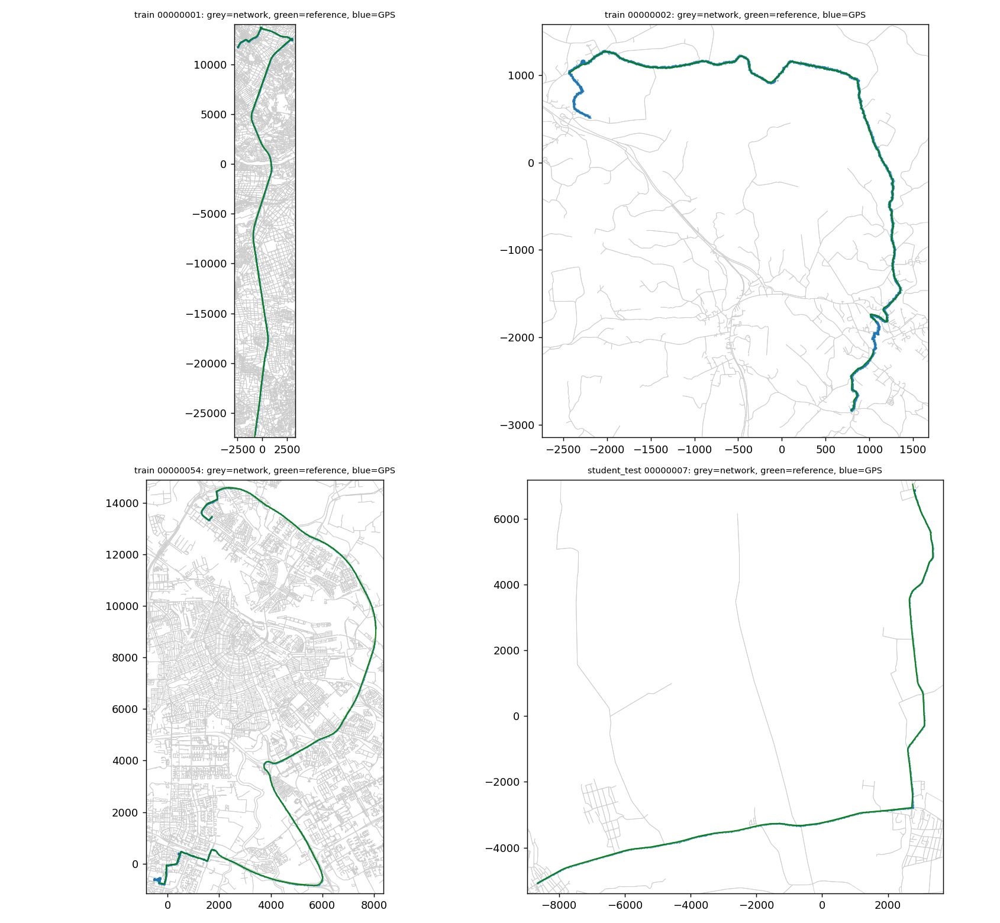

**Folium map:** `maps/eda_train_00000002.html` and `maps/eda_student_test_00000007.html` show GPS points, nearby road arcs and the reference route, with a layer control. _[screenshot]_

### Q1. How did we preprocess the data?

1. **Cleaning.** Drop non-finite or out-of-range fixes, sort by timestamp and drop duplicate timestamps (`io.clean_track`). For this data none were removed, but the step protects the API against bad evaluator files.
2. **Projection** to local metres, as described above.
3. **Labels.** The `.route` file does not say which GPS fix belongs to which arc. We derive per-fix labels with a **monotone dynamic-programming alignment** of fixes to route arcs (`labels.py`). The cost is the point-to-segment distance, and the route index may only stay the same or move forward in time. This respects the route order, which plain nearest-arc snapping does not on roads that are driven twice.
4. **Candidate generation.** Arcs are densified every 10 m into a KD-tree. Each fix gets every arc within **R = 60 m**, capped at the **K = 12** nearest. The candidate miss rate (reference arc not among the candidates) is **0.20% of fixes on student_test** and 11.5% on train. The train figure is driven almost entirely by trips 33, 54 and 2, whose reference routes are more than 60 m from the GPS.
5. **Training filter.** We drop trips 00000033 and 00000054 (median alignment distance above 50 m) and all fixes more than 60 m from their aligned reference arc. These labels are unreliable, and treating the reference as perfect ground truth would teach the model noise. Evaluation keeps every fix.
6. **Point subsampling for model selection.** We keep 35% of fixes, with all of their candidates, giving 485,801 rows. At 1 Hz, neighbouring fixes are almost duplicates, so this costs little information and makes 5-fold CV of eight models feasible.

### Q2. Patterns observed and features extracted

| Feature(s) | Why |
|---|---|
| `dist`, `dist_rank`, `dist_gap`, `dist_ratio`, `n_cand` | The nearest arc is usually right. How much nearer it is than the runner-up measures ambiguity. |
| `head_diff`, `head_cos`, `head_valid`, `speed` | Two-way streets give two geometrically identical candidates; only the direction of travel separates them. Heading comes from fixes i−2 → i+2 and is treated as invalid when displacement is under 3 m (vehicle stopped). |
| `ctx_dist`, `ctx_rank`, `ctx_head_cos` | Mean distance and heading agreement of the 5 previous and 5 next fixes to the same arc. These features add temporal smoothing before the HMM. They are the main fix at junctions and parallel roads. |
| `arc_len`, `t_proj`, `at_end` | A projection clamped to an arc end (t = 0 or 1) usually means the fix belongs to the next or previous arc. |
| `out_deg`, `in_deg`, `two_way` | Local topology (junction complexity). |
| `dt_prev` | Flags gaps. |

All features are computed without the route, so they are identical at inference time.

## 3. Model experimentation and comparison

_Code: `src/pathsnap/training.py`, `scripts/03_train_models.py`. Results: `results/model_comparison.csv`, `results/cv_folds_all_models.csv`, `results/train_models_log.txt`._

**Task.** Binary classification of (fix, candidate) rows. About 12.6% of rows are positive.

**Protocol:**
- 5-fold **GroupKFold by trip** on the training partition: 78 usable trips, 485,801 rows.
- Every model sits in a `StandardScaler → classifier` pipeline. The scaler is fitted on the training folds only.
- After CV, each model is refitted on all training rows and evaluated on the full student_test partition (160,251 rows, 19,160 fixes).
- Seed 42.

**Metrics:**
- Row-level accuracy, macro precision, recall and F1 at threshold 0.5, and log loss.
- **Observation-level Top-1**: argmax candidate per fix equals the reference arc. A fix whose reference arc is missing from its candidates counts as wrong.
- **Route continuity** of the classifier-only argmax sequence: the share of transitions between consecutive distinct predicted arcs that share a node.

**Primary selection metric: CV observation-level Top-1.** It is the quantity that matters for map matching (one arc per fix). Macro F1 at a fixed 0.5 threshold ignores the per-fix competition between candidates. Log loss is the tie-breaker because the HMM consumes the probabilities as emissions.

### 3.1 Overall comparison

| Model | Family | Key configuration | CV Macro F1 (mean ± sd) | CV Top-1 | Student-test Top-1 | Route continuity (clf-only, test) | Student-test Macro F1 | Test log loss | Inference (ms / 1k fixes) |
|---|---|---|---|---|---|---|---|---|---|
| Logistic Regression | Linear | L2, C=1, lbfgs | 0.9378 ± 0.0145 | 0.9026 | 0.8894 | 0.776 | 0.9326 | 0.0763 | 11.4 |
| Gaussian NB | Probabilistic | var_smoothing 1e-9 | 0.9120 ± 0.0132 | 0.8745 | 0.8622 | 0.750 | 0.9047 | 0.3602 | 3.6 |
| KNN | Instance-based | k=25, distance-weighted, 150k-row cap | 0.9336 ± 0.0156 | 0.8946 | 0.8905 | 0.752 | 0.9314 | 0.0977 | 1260.6 |
| Decision Tree | Tree | depth 12, min_leaf 50 | 0.9392 ± 0.0184 | 0.9011 | 0.8908 | 0.780 | 0.9373 | 0.0773 | 1.2 |
| Random Forest | Bagging ensemble | 200 trees, depth 18, min_leaf 5 | **0.9449** ± 0.0164 | **0.9067** | 0.9083 | 0.800 | 0.9431 | 0.0595 | 27.2 |
| HistGradientBoosting | Boosting | 300 iters, lr 0.1, 31 leaves | 0.9432 ± 0.0168 | 0.9041 | 0.9022 | 0.783 | 0.9396 | 0.0634 | 19.0 |
| **XGBoost** | Boosting | 300 trees, lr 0.1, depth 6, subsample 0.8 | 0.9434 ± 0.0161 | 0.9063 | **0.9134** | **0.815** | **0.9449** | **0.0576** | 6.4 |
| MLP | Neural network | 64-32 ReLU, Adam 1e-3, early stopping | 0.9416 ± 0.0142 | 0.9056 | 0.8895 | 0.805 | 0.9332 | 0.0661 | 2.4 |

SVMs were not run: kernel SVMs scale as O(n²) on 485k rows and do not produce probabilities without extra calibration.

**Selection: XGBoost.**
- Its CV Top-1 (0.9063) is statistically tied with Random Forest (0.9067). The difference is far below the fold standard deviation of about 0.03.
- It has the best student-test Top-1, macro F1, log loss and continuity.
- It is 20× faster to fit than Random Forest (8 s vs 163 s) and 4× faster at inference, and the model file is small (2 MB). Both matter for the API.
- It is a natural candidate for Bayesian tuning.

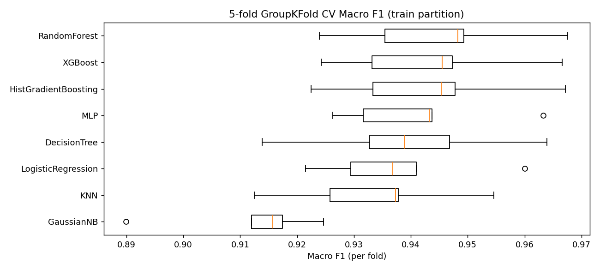
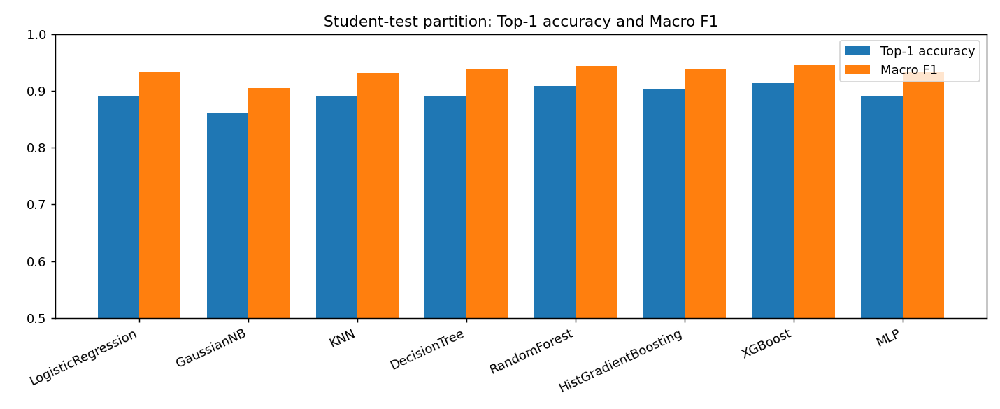
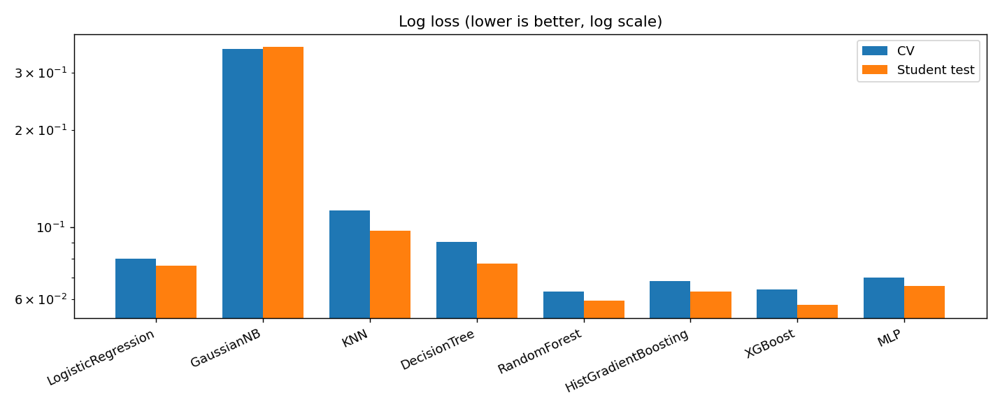
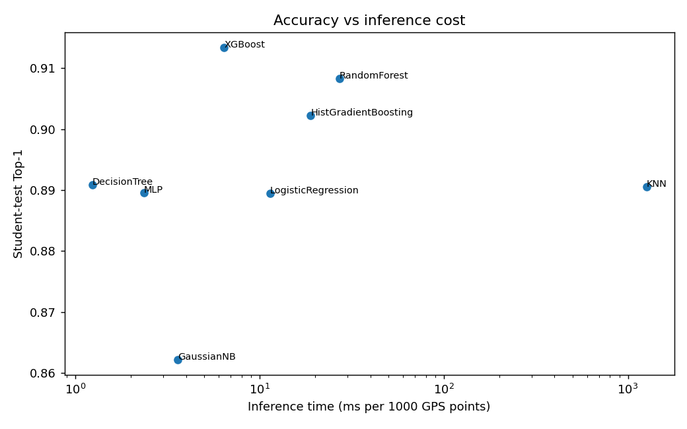
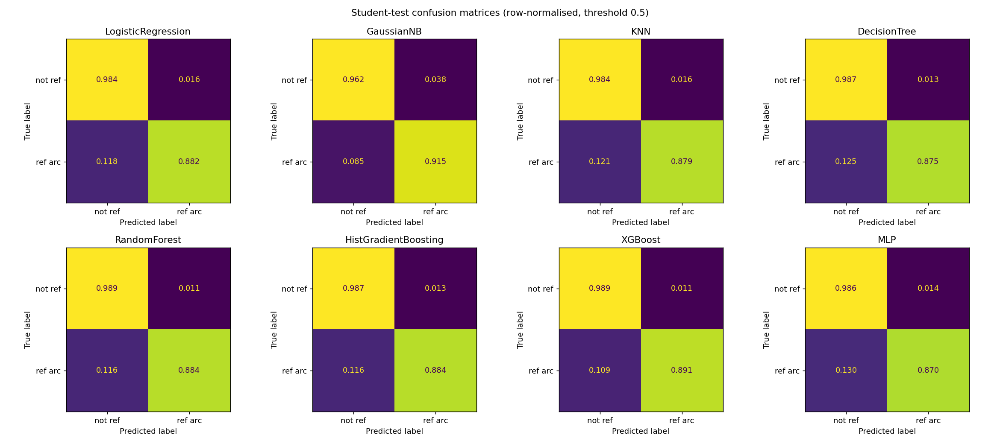

### 3.2 Per-model questions

The overfitting check compares the macro F1 on training-fold rows (`cv_train_f1_macro_mean`) with the CV validation macro F1.

**Logistic Regression**
- **A. Why it fits.** It is a strong, well-calibrated baseline. Most signal is close to monotone in distance and heading cosine, and a linear logit captures that.
- **A. Limitations.** It cannot express interactions such as "heading only matters when speed > 0" or "a clamped projection matters only near junctions".
- **B. Configuration.** C=1.0 (L2), lbfgs, max_iter 1000. Loss: binary cross-entropy plus an L2 penalty.
- **C. Results.** Student-test Top-1 0.8894, macro F1 0.9326, log loss 0.0763.
- **C. Fit.** Train F1 0.9403 vs CV 0.9378, a gap of 0.003. No overfitting, but mild underfitting relative to the tree ensembles (about 0.4 points lower CV Top-1).

**Gaussian Naive Bayes**
- **A. Why it fits.** It is a very fast generative baseline.
- **A. Limitations.** It assumes conditionally independent Gaussian features. Ours are strongly correlated (`dist` / `dist_rank` / `ctx_dist`) and non-Gaussian (`head_diff` is bimodal at 0° and 180°).
- **B. Configuration.** var_smoothing 1e-9. Objective: maximum likelihood of the class-conditional Gaussians.
- **C. Results.** Top-1 0.8622, macro F1 0.9047, log loss 0.360. The log loss is 5–6× worse than the others: the independence assumption counts correlated evidence twice and pushes probabilities to 0 or 1.
- **C. Fit.** Train 0.9103 vs CV 0.9120. Clear underfitting through model bias. Its probabilities are poor emissions for the HMM.

**KNN**
- **A. Why it fits.** It makes no assumption about the decision boundary: a candidate looks like past candidates with similar geometry.
- **A. Limitations.** Prediction is costly: 1.26 s per 1k fixes, 100–500× slower than the trees. It is sensitive to scaling, and we had to cap the reference set at 150k rows.
- **B. Configuration.** k=25, distance weighting, Euclidean distance on standardised features. There is no loss; it is a lazy learner.
- **C. Results.** Top-1 0.8905, macro F1 0.9314, log loss 0.098.
- **C. Fit.** Train F1 0.9667 vs CV 0.9336, a gap of 0.033. This is the largest gap of all models; distance weighting partly memorises the training rows.

**Decision Tree**
- **A. Why it fits.** It produces interpretable threshold rules, for example dist_gap < x and head_cos > y.
- **A. Limitations.** It has high variance and gives piecewise-constant probabilities.
- **B. Configuration.** max_depth 12, min_samples_leaf 50. Objective: Gini impurity.
- **C. Results.** Top-1 0.8908, macro F1 0.9373, log loss 0.077.
- **C. Fit.** Train 0.954 vs CV 0.939. Moderate overfitting, kept in check by the depth limit. It also has the highest fold standard deviation (0.0184).

**Random Forest**
- **A. Why it fits.** Averaging bagged trees reduces the variance of single trees and handles feature interactions.
- **A. Limitations.** Fitting is slow (163 s) and the model is large.
- **B. Configuration.** 200 trees, max_depth 18, min_samples_leaf 5. Objective: Gini.
- **C. Results.** Top-1 0.9083, macro F1 0.9431, log loss 0.0595.
- **C. Fit.** Train 0.9749 vs CV 0.9449, a gap of 0.030. Deep trees memorise individual trips, but bagging keeps the validation score at the top.

**HistGradientBoosting**
- **A. Why it fits.** Boosting on histogram-binned features is fast.
- **A. Limitations.** Defaults without row subsampling give slightly worse probabilities than XGBoost.
- **B. Configuration.** max_iter 300, lr 0.1, 31 leaves. Loss: log loss.
- **C. Results.** Top-1 0.9022, macro F1 0.9396, log loss 0.0634.
- **C. Fit.** Train 0.9595 vs CV 0.9432. Small gap.

**XGBoost (selected)**
- **A. Why it fits.** Gradient boosting with second-order updates, row and column subsampling and L1/L2 regularisation. It is well suited to tabular, interaction-heavy features, and it is fast.
- **A. Limitations.** Many hyperparameters. It can overfit when trees get deep or many.
- **B. Configuration.** 300 trees, lr 0.1, depth 6, subsample 0.8, colsample 0.8. Loss: binary log loss.
- **C. Results.** Top-1 **0.9134**, macro F1 **0.9449**, log loss **0.0576**.
- **C. Fit.** Train 0.9725 vs CV 0.9434. The epoch-wise history (`figures/xgb_loss_curve.png`, trips held out by group) shows validation log loss bottoming at about 0.0524 near round 200 and flat to round 300, while training loss keeps falling to 0.035. That is mild overfitting after about 200 rounds, which motivates tuning.

**MLP**
- **A. Why it fits.** Smooth non-linear decision boundaries and well-behaved probabilities.
- **A. Limitations.** Needs scaling and many epochs. Slightly below the boosted trees on tabular data.
- **B. Configuration.** Layers 64-32, ReLU, Adam lr 1e-3, alpha 1e-4, batch 1024, early stopping. Loss: cross-entropy.
- **C. Results.** Top-1 0.8895, macro F1 0.9332, log loss 0.0661.
- **C. Fit.** The training history (`figures/mlp_loss_curve.png`) shows validation loss falling from 0.0688 to 0.0585 by epoch 20 and then rising slightly to 0.0592 by epoch 40, while training loss keeps falling to 0.0549. Overfitting starts after about 20 epochs, so early stopping is justified.

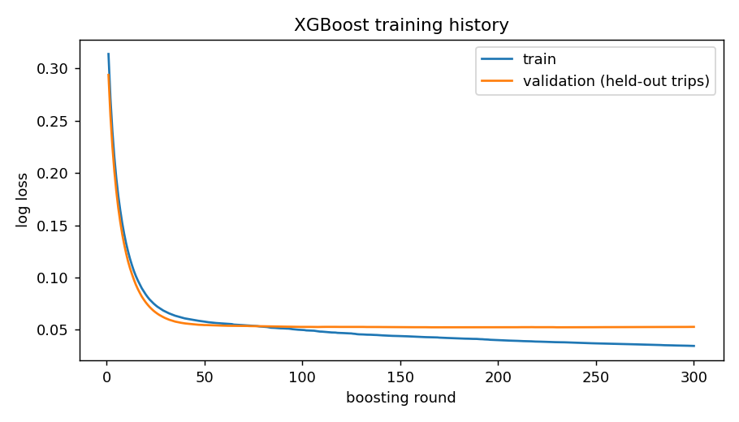
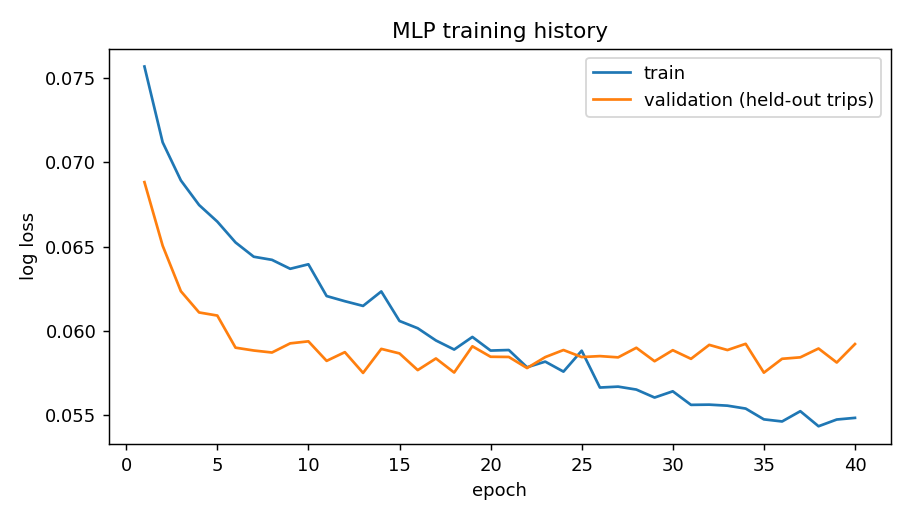

Training curves are shown only for the two models that genuinely have epoch-wise histories (XGBoost boosting rounds and MLP epochs).

## 4. Bayesian hyperparameter optimisation (XGBoost)

_Code: `scripts/04_bayes_opt.py`. Results: `results/bayes_opt_trials.csv`, `bayes_opt_best.json`, `tuned_vs_untuned.csv`._

1. **Hyperparameters and ranges:**
   - n_estimators: 100–800, step 50.
   - learning_rate: 0.01–0.3, log-uniform.
   - max_depth: 3–10.
   - min_child_weight: 1–50, log.
   - subsample: 0.5–1.0.
   - colsample_bytree: 0.5–1.0.
   - reg_lambda: 1e-3–10, log.
   - reg_alpha: 1e-4–1, log.
   - gamma: 1e-4–5, log.
2. **Why these ranges.** They cover capacity (depth, number of trees and learning rate trade off against each other) and regularisation. The untuned learning curve showed mild overfitting.
3. **Objective.** Maximise the mean observation-level Top-1 over **3-fold GroupKFold** on the training partition. We used 3 folds rather than 5 to fit 30 trials into about 8.5 minutes. CV log loss was logged per trial.
4. **Sampler.** Optuna **TPE** (a tree-structured Parzen estimator, i.e. Bayesian optimisation), seed 42, 8 random start-up trials, **30 trials**. The study took 509 s.
5. **Best parameters:** n_estimators 300, learning_rate 0.0212, max_depth 7, min_child_weight 3.89, subsample 0.620, colsample_bytree 0.621, reg_lambda 0.0066, reg_alpha 0.421, gamma 0.0035. Best CV Top-1 was 0.9111 (3-fold).
6. **Tuned vs untuned**, with the same 5-fold CV, partitions and metrics:

| | CV Macro F1 | CV Top-1 | CV log loss | Test Top-1 | Test Macro F1 | Test log loss | Inference (ms / 1k fixes) |
|---|---|---|---|---|---|---|---|
| untuned | 0.9434 | 0.9063 | 0.0645 | **0.9134** | **0.9449** | **0.0576** | 8.8 |
| tuned | **0.9451** | **0.9087** | **0.0628** | 0.9044 | 0.9416 | 0.0597 | 9.3 |

**Did tuning help?**
- On the 78 training trips (5-fold CV), yes: all three CV metrics improved.
- On the 10 student-test trips, the tuned model is 0.9 points lower in Top-1.
- Both differences are smaller than the fold standard deviation (about 0.029), so the honest conclusion is that tuning gave **no significant change**.
- We kept the tuned model because it was chosen by CV, which follows the guideline that selection must not be driven by a 10-trip test set. The lower learning rate also gives smoother probabilities.
- After the HMM, the difference between the two disappears (Section 5).

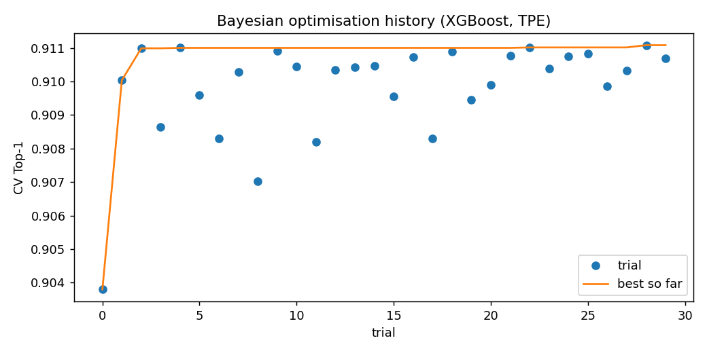
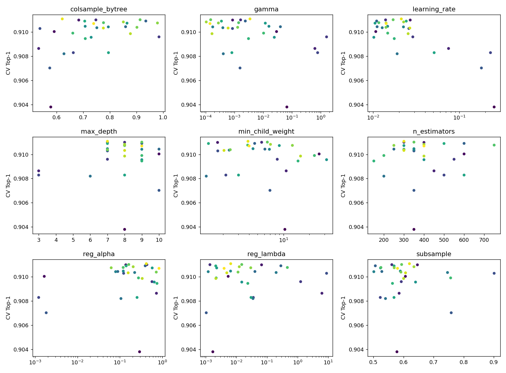

## 5. HMM and Viterbi route reconstruction

_Code: `src/pathsnap/hmm.py`, `scripts/05_hmm.py`. Results: `results/hmm_grid_search_train.csv`, `hmm_student_test_per_trip.csv`, `hmm_student_test_summary.json`._

1. **Hidden states.** At fix i, the states are the candidate arcs C_i (up to 12), each with its projected position t on the arc. Every state stores its arc id, so the candidate-to-arc mapping is kept explicitly.
2. **Emission.** `log E_i(c) = w · log max(p_clf(c), 1e-6)`, where p_clf is the tuned XGBoost probability.
3. **Transition.** `log T(c' → c) = −| d_route − d_gc | / (β · √Δt)`.
   - d_gc is the straight-line distance between the two fixes.
   - d_route is the driving distance through the directed graph, from the projection on c' to the projection on c. It equals the remainder of c', plus the Dijkstra distance from c'.to to c.from, plus the offset on c. For the same arc it is |Δposition|.
   - Dijkstra is bounded by a cutoff of 100 m + 2·d_gc + 25 m/s·Δt and is cached per source node.
   - The √Δt factor relaxes the constraint across gaps.
   - Recurrence: `δ_i(c) = E_i(c) + max_{c'} [δ_{i−1}(c') + log T(c', c)]`, with back-pointers. Backtracking starts from argmax δ_N.
4. **Missing candidates and gaps.**
   - A fix with no candidates is skipped (output −1).
   - The next fix is linked to the last valid one using the accumulated Δt, which widens both the cutoff and the β·√Δt tolerance.
5. **Disconnected segments.**
   - A pair that is unreachable within the cutoff gets probability 0 (−∞).
   - If every transition into fix i is −∞, the chain **breaks**: the segment so far is decoded and Viterbi restarts at fix i from the emissions alone. Student test had 3 breaks in 19,160 fixes.
   - For the output route, consecutive distinct decoded arcs that are not adjacent are joined with the network shortest path.
6. **Decoder tuning.**
   - Only the product β·w matters, because multiplying both terms by a constant leaves the argmax unchanged. The grid in `figures/hmm_grid_search.png` confirms this: equal products give identical scores.
   - We searched β ∈ {0.5…100} × w ∈ {0.1…2} on **25 training trips**, using **out-of-fold** probabilities: each trip was scored by a model that never saw it.
   - Best β·w = 1.25 (β = 5, w = 0.25), with 0.9617 OOF point accuracy. The optimum is interior: 1.0 gives 0.9608 and 2.0 gives 0.9570.
   - The student-test partition was not used to choose any parameter.

**Results on student_test** (point accuracy weighted by fixes; other metrics are trip means):

| | Point accuracy | Route continuity | Arc F1 | Length-weighted route F1 |
|---|---|---|---|---|
| Classifier only (argmax) | 0.9044 | 0.801 | 0.775 | 0.846 |
| Distance-only HMM (Gaussian emission, σ = 5 m, no classifier) | 0.9128 | 0.903 | – | 0.982 |
| **Classifier + HMM (final)** | **0.9549** | **0.912** | **0.975** | **0.989** |

**Analysis:**
- The HMM adds **+5.0 points** of point accuracy over the classifier alone and lifts route F1 from 0.85 to 0.99.
- The classifier-only route is noisy. Jitter between parallel or opposite-direction arcs creates on average 411 arc changes per trip against 329 for the HMM. Many of these spurious arcs pull arc precision down to 0.65.
- The classifier is still worth having: it beats the plain distance-based HMM by **+4.2 points**.
- The HMM never lowered point accuracy on any test trip. The largest gains were on trips 00000077 (0.797 → 0.915) and 00000076 (0.936 → 0.978).
- **It did not help much** on 00000065 (0.8945 → 0.8958, where the distance-only HMM did better at 0.906) or 00000009 (0.882 → 0.905). These trips have dense junctions with very short arcs (median route arc 19 m on trip 9). There, the 1 Hz fixes legitimately skip arcs, and the labels themselves are ambiguous at arc boundaries.
- Continuity stays below 1 for the same reason. It is measured on the decoded per-fix arcs, before gap filling, and short arcs passed between two fixes count as breaks. After shortest-path filling, the output route is connected except where the chain broke.
- Remaining errors come mostly from reference limitations, such as off-network driving at trip ends where the route has stopped (student_test 00000007), rather than from decoding.

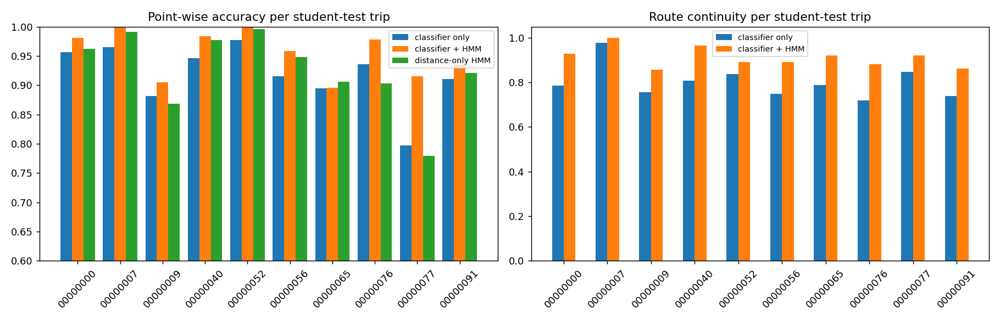
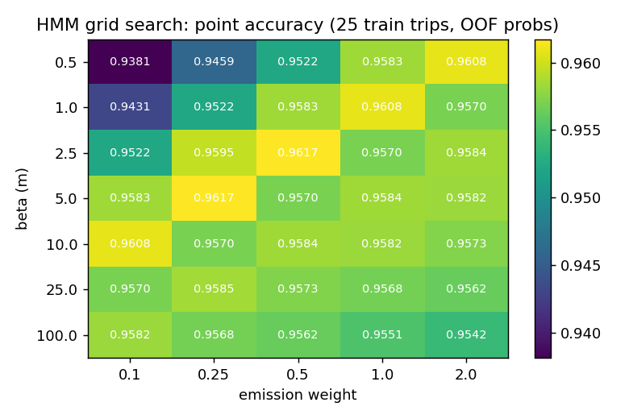

## 6. Geographical visualisation (Folium)

`src/pathsnap/viz.py` produces `maps/pred_student_test_<id>.html` for every student-test trip. Each map has the following layers:

- Blue circle markers: GPS observations.
- Grey: nearby road-network arcs (hidden by default).
- Thick green: reference route.
- Red: predicted route (classifier + HMM).
- Orange: classifier-only arcs.
- Start and end markers, a legend, a layer control, and fit-to-bounds zoom.

_[screenshot of maps/pred_student_test_00000077.html]_. A static equivalent of the same overlay:

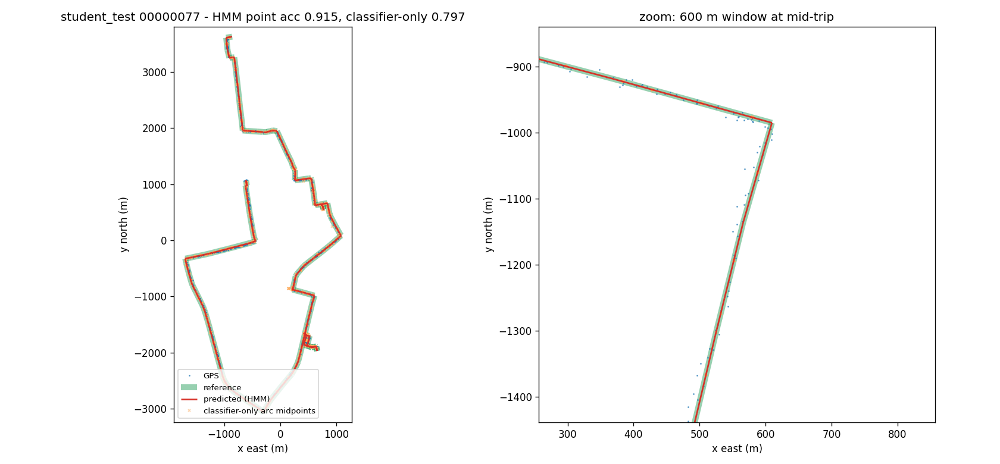
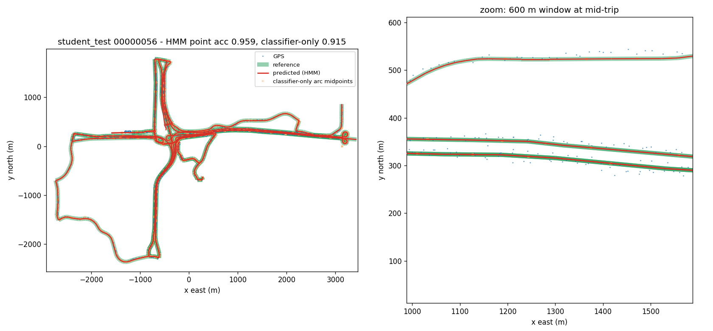

## 7. API, UI and deployment

- **Laptop 1** runs `uvicorn api.main:app --host 0.0.0.0 --port 8000`. It loads `artifacts/final_model.joblib`, `artifacts/inference_config.json` and the evaluator trips from `data/raw/eval_test/`.
- `POST /predict {trip_id}` runs the full pipeline: candidates, features, XGBoost, Viterbi, route reconstruction.
- After predicting, the API reads the reference route server-side and scores the prediction: point accuracy (HMM and classifier-only), candidate miss rate, continuity, and arc/length precision, recall and F1.
- The response contains only the predicted geometry, the GPS points and the metrics. The reference geometry is never sent.
- Each request is logged to the console and to `results/api_requests.log`, for example:
  `RESULT trip=00000000 points=2503 hmm_acc=0.9844 clf_acc=0.9592 continuity=0.936 len_f1=0.9971 total=0.62s`
- **Laptop 2** runs `streamlit run ui/app.py`. It lists the 10 trips from `/trips`, sends the selected id to `/predict`, and draws the GPS points and predicted route on a Folium map with the metrics and timings.
- **Integration test.** `scripts/06_test_api.py` succeeded on all 10 student-test trips: mean API time 1.0 s per trip; mean point accuracy 0.953 (HMM) vs 0.910 (classifier-only); mean length F1 0.989. Results are in `results/api_integration_student_test.csv`.

_[Screenshot: UI trip selector + results]_   _[Screenshot: API console log on Laptop 1]_

## 8. Limitations and conclusions

- The reference routes are treated as references, not as verified truth. Two training trips disagree systematically with their GPS. The per-fix labels come from our own alignment, and at arc boundaries a fix can legitimately belong to either neighbour.
- Model choice matters less than sequence modelling. All tree ensembles land within 0.5 points of each other in CV Top-1, while the HMM adds 5 points.
- Possible next steps:
  - Learn the transition model (for example, a classifier over Δ = |d_route − d_gc| and turn angle).
  - Add per-trip noise estimation to adapt σ and β.
  - Handle off-network segments with an explicit "off-road" state.

## Appendix: reproducibility

All numbers can be regenerated with scripts 02 → 01 → 03 → 04 → 05 (see the README). Seed 42. Logs are in `results/*_log.txt`.
